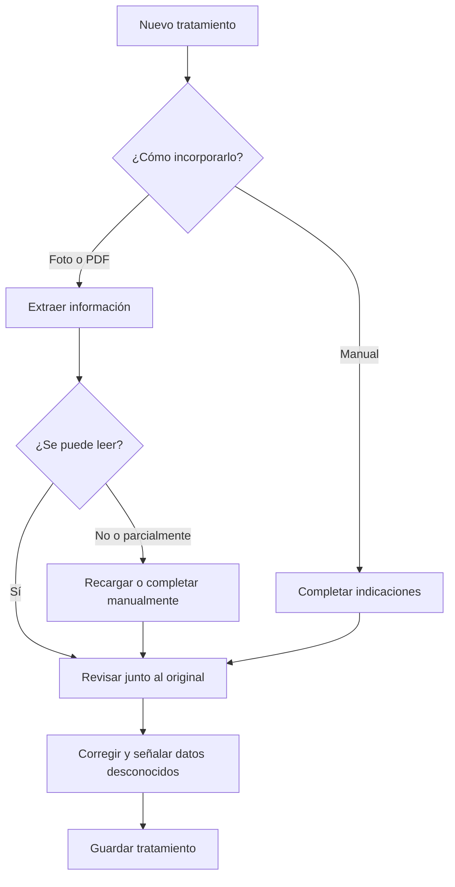
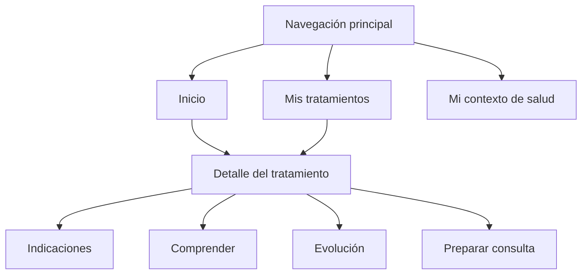

# My Med History — análisis funcional del MVP

## 1. Propósito y contexto

La aplicación acompaña al paciente desde que recibe un tratamiento hasta su siguiente consulta, ayudándolo a comprender las indicaciones, registrar su experiencia y formular mejores preguntas.

Este análisis organiza lo acordado como un backlog inicial de producto. Los nombres y la distribución de pantallas son propuestas para validar, no decisiones visuales definitivas.

### Objetivo de producto

> Que una persona pueda transformar una receta en un tratamiento comprensible, seguir su evolución y preparar una consulta informada, sin que la aplicación sustituya las decisiones médicas.

- **Usuario principal:** paciente con un tratamiento indicado.
- **Participación del médico:** recibe la información que el paciente decida mostrarle durante la consulta. No necesita una cuenta ni un portal en esta primera versión.
- **Contexto del MVP:** demo local de portafolio, contextualizada en Perú, con casos ficticios y sin registro de usuarios inicialmente.

## 2. Épicas e historias de usuario

| Épica | Historia principal | Valor para el paciente |
|---|---|---|
| E1. Incorporar un tratamiento | Como paciente, quiero cargar una receta o escribir sus indicaciones para reunirlas en un lugar. | No depender de documentos dispersos. |
| E2. Revisar lo registrado | Como paciente, quiero contrastar la extracción con el original para corregir errores y reconocer información faltante. | Evitar que una lectura equivocada se convierta en una indicación. |
| E3. Comprender el tratamiento | Como paciente, quiero entender su propósito, funcionamiento, efectos y cuidados, con fuentes consultables. | Participar mejor informado en mi cuidado. |
| E4. Registrar mi evolución | Como paciente, quiero anotar cómo me siento y las dificultades que encuentro sin llenar formularios extensos. | Conservar mi experiencia, no solo la receta. |
| E5. Preparar mi consulta | Como paciente, quiero reunir preguntas y un resumen de mi evolución para conversar con el médico. | Aprovechar mejor la consulta. |
| E6. Conservar mi historial | Como paciente, quiero consultar tratamientos anteriores y sus registros. | Dar continuidad a mi historia de salud. |

Un contexto básico —otros medicamentos, alergias y condiciones conocidas— complementa estas épicas, pero no bloquea el ingreso inicial.

## 3. Flujos principales

### Flujo A. Incorporar un tratamiento

**Inicio:** el paciente recibe una receta o instrucciones.

1. Selecciona **Nuevo tratamiento**.
2. Adjunta una foto/PDF o elige el registro manual.
3. La aplicación extrae la información y prepara un borrador.
4. El paciente compara el borrador con el documento original.
5. Corrige los datos, confirma lo legible y deja señalado lo desconocido.
6. Guarda el tratamiento.

**Resultado:** un tratamiento registrado y trazable, disponible para comprenderlo y darle seguimiento.

Alternativas: recargar un documento ilegible, completar manualmente, guardar datos incompletos o reintentar un procesamiento fallido sin perder el registro.

**Revisado por el paciente no significa validado médicamente.**

### Flujo B. Comprender y aclarar

**Inicio:** existe información revisada del tratamiento.

1. El paciente solicita una explicación.
2. La aplicación distingue las indicaciones registradas de la información educativa.
3. Explica lo que puede respaldar e identifica sus límites.
4. Propone preguntas sobre aspectos relevantes o incompletos.
5. El paciente selecciona, modifica o añade preguntas propias.

**Resultado:** una explicación consultable y una lista de dudas.

Las cuestiones que requieren aclaración antes de iniciar el tratamiento no deben presentarse como asuntos que necesariamente pueden esperar a la próxima cita.

### Flujo C. Registrar la evolución

**Inicio:** el paciente está siguiendo el tratamiento.

1. Registra un chequeo breve o una novedad espontánea.
2. Puede indicar cómo se siente, molestias, dificultades, tomas o mediciones relevantes.
3. Revisa lo interpretado si escribió una nota libre.
4. Guarda el registro con su fecha.

**Resultado:** una línea de tiempo de experiencias declaradas por el paciente.

No registrar una toma no equivale a haberla omitido. Un síntoma posterior a una toma tampoco demuestra causalidad.

### Flujo D. Preparar la consulta

1. El paciente abre **Preparar consulta** dentro del tratamiento.
2. Revisa sus preguntas pendientes.
3. Selecciona el período que quiere resumir.
4. Obtiene un resumen de indicaciones, registros y dificultades.
5. Contrasta el resumen con sus anotaciones antes de mostrarlo.

**Resultado:** información organizada para conversar, no una conclusión diagnóstica.

### Flujo E. Consultar un tratamiento anterior

El paciente accede a sus tratamientos archivados y consulta las indicaciones, documentos, evolución y preguntas relacionadas.

**Archivar es una acción organizativa:** no significa que la aplicación haya indicado terminar el tratamiento ni que la enfermedad esté resuelta.

## 4. Pantallas propuestas

| Pantalla | Contenido principal | Acciones |
|---|---|---|
| Inicio | Tratamientos en seguimiento, borradores pendientes y registros recientes. | Nuevo tratamiento, continuar revisión, registrar evolución. |
| Mis tratamientos | Listado de tratamientos: borradores, en seguimiento y archivados. | Abrir, crear o archivar. |
| Nuevo tratamiento | Carga o ingreso manual; nombre y motivo si se conocen. | Adjuntar, completar, guardar borrador. |
| Revisión de indicaciones | Original y extracción, con campos ausentes o dudosos. | Corregir, confirmar o dejar sin especificar. |
| Detalle del tratamiento | Información organizada en cuatro secciones. | Consultar, añadir registros y preparar preguntas. |
| Registrar evolución | Formulario breve con notas y campos opcionales pertinentes. | Guardar, corregir o cancelar. |
| Mi contexto de salud | Otros medicamentos, alergias y condiciones conocidas según lo declarado. | Añadir, corregir y marcar información desconocida. |

El detalle del tratamiento se divide en:

- **Indicaciones:** lo registrado, documento original y cambios fechados.
- **Comprender:** explicación, cuidados, posibles efectos y fuentes.
- **Evolución:** registros cronológicos y acceso al chequeo breve.
- **Preparar consulta:** preguntas propias, sugeridas y resumen.

Las preguntas y observaciones conservan su relación con el tratamiento correspondiente.

## 5. Navegación

Destinos principales: **Inicio**, **Mis tratamientos** y **Mi contexto de salud**. **Nuevo tratamiento** es una acción destacada, no otra sección permanente.

- Desde Inicio se puede continuar un borrador o abrir un tratamiento.
- Desde Mis tratamientos se accede al detalle.
- Desde el detalle se consulta información, registra evolución y prepara la consulta.
- Después de guardar una evolución se regresa al tratamiento correspondiente.
- El documento original permanece accesible desde sus indicaciones.

No se incluye un chat general: la asistencia se vincula a información y objetivos concretos.

## 6. Criterios de aceptación esenciales

### Registro y revisión

- La extracción no se convierte automáticamente en una indicación confirmada.
- Lo desconocido permanece incompleto.
- Las correcciones no eliminan silenciosamente el original ni cambios anteriores.

### Explicaciones

- Se distingue documento, paciente y aplicación.
- Las referencias pueden consultarse.
- La aplicación reconoce sus límites.
- No recomienda suspender, sustituir o cambiar dosis.

### Seguimiento y resumen

- Se puede registrar una novedad sin completar todos los campos.
- El resumen no inventa tomas, síntomas ni conclusiones.
- Los registros originales siguen disponibles.

### Experiencia general

- Estados claros de carga, vacío, error y procesamiento pendiente.
- Un fallo de IA no impide consultar indicaciones guardadas ni registrar evolución.
- Navegación móvil y mediante teclado.

## 7. Entregas incrementales propuestas

| Incremento | Resultado demostrable |
|---|---|
| 1. Registrar con confianza | Cargar una receta ficticia, revisar la extracción y guardar el tratamiento. |
| 2. Entender y preguntar | Obtener explicaciones respaldadas y preparar dudas. |
| 3. Seguir y resumir | Registrar evolución y preparar el resumen de consulta. |

No se fijan todavía duraciones de sprints. El éxito se mide por completar recorridos y manejar incertidumbre, no por afirmar mejoras clínicas no acreditadas.

## 8. Fuera de alcance

Portal médico, integraciones hospitalarias, cambios autónomos de tratamiento, diagnóstico, prescripción y vigilancia médica continua.

Esta propuesta no incluye maquetas ni validación clínica. Los diagramas representan flujos y navegación funcional, no diseños de interfaz ni arquitectura técnica.
