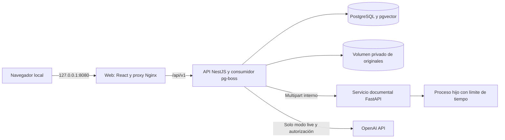

# My Med History — diseño técnico del MVP local

Fecha: 2026-10-25. Estado: **propuesto para revisión humana**. Complementa el [análisis funcional](../../producto/analisis-funcional.md) y los [casos de evaluación](../../qa/casos-evaluacion.md).

## 1. Intención, alcance y decisiones

Aplicación de portafolio para un paciente por instalación local. Conecta indicaciones ya recibidas, explicación educativa respaldada, vivencias y preguntas para el profesional. No es una herramienta diagnóstica, prescriptiva ni un sistema de alertas médicas continuo.

### Acuerdos del usuario

- Uso local al clonar el repositorio; contexto de referencia Perú.
- Foto/PDF con extracción revisable y entrada manual alternativa.
- Seguimiento ligero opcional y preparación de consulta.
- Backend modular NestJS más servicio documental Python/FastAPI/PaddleOCR.
- PostgreSQL con pgvector, pg-boss en lugar de Redis y LLM por API.
- Casos ficticios, una persona por instalación y sin login inicialmente.
- Manuscritos sin garantía de reconocimiento; no hay motor exhaustivo de interacciones.
- Modo demostración utilizable sin API key; modo live explícito.

### Elecciones técnicas del autor, delegadas por el usuario

- OpenAI, Responses API y SDK oficial. Modelo inicial `gpt-5.4-mini-2026-03-17`; embeddings `text-embedding-3-small`, 1536 dimensiones. Elegidos por capacidad documentada y coste, **no por superioridad clínica demostrada**.
- React/Vite, Drizzle, SQL y npm workspaces; sin Nx/Turborepo ni framework de agentes.
- Resumen de consulta determinista: selecciona y presenta registros, no requiere otra generación.
- Dos medicamentos orales en el corpus inicial, no cobertura universal. AEMPS/CIMA como referencia documental en español; claramente distinta de una ficha peruana.
- Límites operativos conservadores y ajustables solo desde configuración del servidor.

## 2. Enfoques considerados

| Alternativa | Ventaja | Coste / decisión |
|---|---|---|
| Next.js full-stack más OCR auxiliar | Menos separación frontend/backend. | Se descarta en favor de NestJS para mostrar backend modular y contratos explícitos. |
| NestJS modular más procesamiento documental independiente | Un solo dominio y base de negocio; aísla dependencias y consumo del OCR. | **Elegida.** Dos runtimes, pero una única aplicación de negocio. |
| Microservicios por tratamiento, paciente e IA | Despliegue independiente por dominio. | Se descarta: distribución, consistencia y operación sin necesidad real. |

Redis/BullMQ, bases vectoriales independientes y Kubernetes no aportan valor suficiente al MVP.

## 3. Topología y límites de confianza



- Compose ejecuta `web`, `api`, `documents` y `db`. El consumidor pg-boss vive inicialmente en el proceso NestJS; no hace inferencia de CPU allí.
- La API requiere DB lista, pero no depende de que OCR o el proveedor externo estén ready: una falta de pesos o key no debe bloquear la demo ni el registro manual.
- Solo `web` publica puerto: `127.0.0.1:8080:80`. Ni PostgreSQL ni OCR ni API se exponen al host por defecto.
- El navegador habla al mismo origen; Nginx reenvía `/api/v1`. No se habilita CORS abierto.
- Nginx y API aceptan únicamente los hosts `localhost:8080` y `127.0.0.1:8080`; rechazan otros para mitigar DNS rebinding.
- En escrituras, validar Origin contra esos dos orígenes cuando esté presente; rechazar `Sec-Fetch-Site: cross-site`. No aceptar formularios urlencoded donde el contrato exige JSON. Estas defensas no sustituyen autenticación para exposición pública.
- El servicio documental no recibe URLs ni rutas arbitrarias y no posee credenciales de PostgreSQL ni de OpenAI. La API le envía los bytes mediante multipart.
- Sin API gateway adicional, mensajería externa, shell proporcionada por usuarios ni herramientas accesibles al LLM.

## 4. Stack y reproducibilidad

Baseline comprobada en registros públicos el 2026-10-25; **compatibilidad conjunta pendiente de ejecutar**:

| Componente | Baseline |
|---|---|
| Node.js | 24 LTS, contenedores Linux |
| TypeScript | 5.x; seleccionar patch compatible al generar lockfile |
| NestJS | 12.2.0 |
| React | 19.3.1 |
| Vite | 8.3.5 |
| Drizzle ORM | 0.45.4; driver `pg` y drizzle-kit compatible |
| pg-boss | 12.38.0; esquema separado `pgboss` |
| OpenAI SDK | 7.43.0 |
| Zod | 4.6.7; contratos HTTP y Structured Outputs |
| PostgreSQL / pgvector | PostgreSQL 17 con pgvector 0.8.7 |
| Python | 3.11, Linux amd64 de referencia |
| FastAPI | 0.162.0; Pydantic 2 y Uvicorn compatibles |
| PaddleOCR / PaddlePaddle CPU | 3.7.0 / 3.3.1, sujetos al smoke test |
| Lectura y rasterizado PDF | pypdf 6.21.2 + pypdfium2 5.14.0 |
| Imágenes | Pillow 13.0.0 |
| Pruebas | Vitest, Supertest, pytest, Playwright 1.64.1 |

Los paquetes auxiliares se fijan con `package-lock.json` y un lock Python al implementar. Dockerfiles fijan versiones y posteriormente digests; no usar `latest` como contrato de reproducción. La versión de Node satisface los requisitos consultados de Vite, pg-boss y OpenAI.

Paddle usa detector `PP-OCRv5_mobile_det`, reconocedor `latin_PP-OCRv5_mobile_rec`, idioma `es`, CPU, sin VL ni modelos de tablas/fórmulas. Fijar nombres, versiones y hashes descargados en un manifiesto del modelo. Descargar explícitamente en la preparación local; no hacerlo ante cada documento ni incluir pesos grandes en Git.

Referencia de prueba propuesta: equipo con 16 GiB de RAM y 8 GiB disponibles para Docker, CPU sin GPU. **No es un mínimo validado**. Windows con WSL2/Docker Desktop es el camino principal; Linux amd64 también. ARM64 requiere evaluación separada, no se promete soporte nativo inicial.

## 5. Módulos y estructura objetivo

```text
apps/api/src/
  config/             configuración validada
  database/           conexión y esquema Drizzle
  health/             salud de infraestructura
  context/            contexto del único paciente
  treatments/         borradores y revisiones inmutables
  documents/          originales, extracción y cliente OCR
  jobs/               configuración y consumidores pg-boss
  knowledge/          corpus, importación y búsqueda
  assistance/         proveedor, presupuesto y análisis
  evolution/          vivencias y tomas explícitas
  questions/          preguntas guardadas y respuestas declaradas
  summaries/          resumen determinista
apps/web/src/
  app/                router y shell
  features/           pantallas agrupadas por funcionalidad
  shared/             cliente HTTP y componentes accesibles mínimos
packages/contracts/src/  esquemas Zod públicos e inferencia de tipos
services/documents/app/  FastAPI, validación, PDF y OCR
data/demo/               casos sintéticos y resultados rotulados
data/corpus/             manifiesto, fragmentos y atribuciones
tests/e2e/              recorridos completos sin llamadas de pago
```

No crear repositorios genéricos, CQRS, event sourcing ni capas vacías. Cada módulo mantiene su lógica y SQL. Python no importa reglas clínicas del backend ni escribe sus tablas.

## 6. Modelo de datos

IDs UUID, tiempos UTC `timestamptz`, presentación `es-PE` / `America/Lima`. Importes de presupuesto en centavos enteros. No calcular dosis con coma flotante.

| Tabla | Campos relevantes y reglas |
|---|---|
| `patient_context` | Fila singleton; `version`, `allergies`, `conditions`, `otherMedications` como listas declaradas; estado explícito unknown/reported_none/reported para distinguir ausencia de datos. |
| `treatments` | `id`, `title`, `reason`, `status` draft/following/archived, `currentRevision`, fechas y `deletedAt`. Archivar no significa completar médicamente. |
| `treatment_drafts` | Una fila editable por tratamiento; `version`, `baseRevision`, `snapshot` JSONB y `updatedAt`. Guardar no confirma ni cambia el estado; CAS por versión y revisión base. |
| `treatment_revisions` | `id`, `treatmentId`, `revision`, `snapshot` JSONB, `documentIds`, `confirmedAt`, `changeReason`. Único `(treatmentId, revision)`; nunca actualizar un snapshot confirmado. |
| `documents` | `id`, `treatmentId`, `storageKey`, `sha256`, `mime`, `bytes`, `generation`, `status`, `attemptCount`, `errorCode`, `deletedAt`. Nombre visible separado de ruta interna. |
| `document_extractions` | Único `(documentId, generation)`; texto literal, páginas/bloques, método native/ocr/mixed, versiones de modelo, advertencias. |
| `evolution_entries` | `id`, `treatmentId`, `kind`, `occurredAt`, `payload` JSONB validado, `originalText`, `version`, `updatedAt`. Tipos checkin/intake/symptom/measurement/note. |
| `questions` | `id`, `treatmentId`, `text`, `origin` patient/app, `analysisId` nullable, `status` pending/discussed, `reportedAnswer` nullable. Las respuestas se atribuyen al relato del paciente. |
| `analysis_runs` | `id`, `treatmentId`, `kind` structure/explanation/questions, `status` queued/processing/ready/failed, `requestHash`, `inputSnapshot`, `result`, `sourceSnapshot`, `externalConsent`, `model`, `promptVersion`, uso y error seguro. Único `requestHash`. Consentimiento live ligado a propósito/hash del input, fecha y versión del aviso. |
| `knowledge_sources` | ID y versión, URL, título, emisor, país, idioma, producto, sustancia, vía, forma/concentración, fechas, permisos, hash, estado activo, aprobación documental. No equivale a revisión clínica. |
| `knowledge_chunks` | `id`, `sourceId`, sección, texto y offsets, `scope` product/substance_route_formulation, `embedding vector(1536)` nullable, modelo y hash del texto. FK e índice por sustancia/vía en las fuentes. |
| `ai_usage` | Intento, operación, día UTC, modelo, reserva en centavos, tokens reportados y estado. Sin prompts ni textos clínicos. |

FK con eliminación en cascada para datos del tratamiento, salvo fuentes globales y contadores agregados de consumo. DELETE treatment marca deletedAt en tratamiento y documentos en una transacción, impide nuevas lecturas/trabajos y cancela pendientes. El limpiador conserva storageKeys hasta completar unlink de todos los originales; después elimina físicamente el tratamiento y aplica las cascadas. Si falla unlink, conserva tombstones para reintento; no borra prematuramente la información necesaria para limpiar ni devuelve los originales. Los jobs guardan IDs, no documentos o prompts, y comprueban existencia/generación/tombstone antes de publicar resultados.

DELETE document borra original y extracción, elimina inputs/resultados de estructuración que contengan su texto y conserva un marcador de documento eliminado para las referencias históricas. La confirmación UI avisa de que las indicaciones ya incorporadas a revisiones y las vivencias siguen perteneciendo al historial del tratamiento; para eliminar ese conjunto se usa DELETE treatment. No anunciar el borrado de un archivo como borrado de todas sus transcripciones históricas.

No almacenar expedientes completos como embeddings. No crear índice HNSW al inicio: corpus pequeño y búsqueda exacta.

## 7. Contratos compartidos

Los nombres siguientes son normativos para API y frontend. Los esquemas Zod son la fuente de validación y tipos TypeScript; los contratos Pydantic equivalentes se prueban con el mismo fixture JSON, sin generar un framework de traducción.

```typescript
type FieldValue = {
  value: string | null;
  provenance: 'document' | 'patient';
  evidence: { documentId: string; page: number; quote: string } | null;
  issue: 'missing' | 'ambiguous' | null;
};
type MedicationInstruction = {
  id: string;
  name: FieldValue;
  strength: FieldValue;
  form: FieldValue;
  dose: FieldValue;
  route: FieldValue;
  schedule: FieldValue;
  duration: FieldValue;
  instructions: FieldValue;
  referenceSelection: {
    substanceId: string;
    routeCode: string;
    formulationCode: string;
    productId: string | null;
  } | null;
};
type TreatmentSnapshot = {
  medications: MedicationInstruction[];
  generalInstructions: FieldValue[];
};
type ConfirmRevisionInput = {
  expectedRevision: number;
  expectedDraftVersion: number;
  changeReason: string;
};
type SaveDraftInput = {
  expectedDraftVersion: number;
  baseRevision: number;
  snapshot: TreatmentSnapshot;
};
type ExtractBlock = {
  page: number;
  text: string;
  box: [number, number, number, number] | null;
  score: number | null;
};
type DocumentExtraction = {
  schemaVersion: '1';
  documentId: string;
  generation: number;
  method: 'native' | 'ocr' | 'mixed';
  pages: number;
  text: string;
  blocks: ExtractBlock[];
  warnings: string[];
};
type ClinicalClaim = {
  text: string;
  chunkIds: string[];
  quote: string;
};
type AssistanceResult = {
  explanation: ClinicalClaim[];
  concernsToDiscuss: ClinicalClaim[];
  questions: string[];
  limitations: string[];
};
type ApiError = {
  code: string;
  message: string;
  requestId: string;
};
```

Validación: cadenas de campos máximo 1000 caracteres, título 120, motivo 1000, hasta 20 medicamentos, 20 instrucciones generales, pregunta 500, nota 2000. Arrays pueden estar vacíos en borrador; confirmar requiere al menos un medicamento con nombre no vacío o una instrucción general no vacía. Un nombre desconocido puede mantenerse en instrucciones generales sin inventarlo.

Campos ausentes son `null`, no cadenas con dosis inventadas. Puntuación OCR es una señal técnica, **no probabilidad de seguridad o exactitud clínica**. Las citas de extracción deben existir literalmente en la página; el contenido corregido por el usuario cambia su procedencia a patient y conserva el documento enlazado.

`referenceSelection` es una selección del catálogo pequeño que el paciente revisa junto con nombre, vía y forma; puede ser null. El OCR/LLM no establece una equivalencia comercial: la salida de estructuración exige referenceSelection null. Solo el catálogo local puede proponer un alias exacto que después se muestra para confirmar; la confirmación de la revisión incluye esa selección. Si solo se reconoce sustancia/vía/forma, productId permanece null. Formulación o vía desconocidas mantienen la selección null y limitan la explicación. Guardar borrador no confirma esa identificación.

Crear un tratamiento crea borrador vacío versión 0 y baseRevision 0. PUT draft incrementa su versión sin modificar la revisión vigente. POST revisions exige currentRevision y versión de borrador actuales, lee el snapshot persistido, inserta la revisión inmutable y retira ese borrador en una transacción. Una edición posterior crea un nuevo borrador con baseRevision igual a la revisión vigente y expectedDraftVersion 0. Borradores conflictivos reciben 409 y no se fusionan ni confirman automáticamente.

Estados HTTP y enumeraciones no se traducen; el texto de interfaz sí está en español. Rechazar propiedades desconocidas en escrituras, límites y fechas inválidas. Body JSON máximo 256 KiB.

## 8. API de negocio

Prefijo `/api/v1`. Respuestas de colección paginadas por `limit` (20, máximo 100) y `offset`; fechas ISO-8601. HTTP 400 validación, 404 inexistente, 409 revisión obsoleta/operación incompatible, 413 límites, 415 tipo, 422 contenido no procesable, 429 presupuesto/límite, 503 proveedor no disponible.

| Método y ruta | Entrada / salida relevante |
|---|---|
| `GET /health` | Estado API y DB; distingue capacidades OCR/IA no disponibles sin bloquear lo manual. |
| `GET /capabilities` | `aiMode`, `liveAvailable`, `documentProcessingAvailable`, límites; nunca revela secretos. |
| `GET /reference-catalog` | Sustancias, aliases exactos, vías, formas y productos del catálogo local para revisar referenceSelection; no busca en internet ni exige selección para guardar. |
| `GET /context`, `PUT /context` | Contexto singleton y versión; PUT exige `expectedVersion`. |
| `GET /treatments`, `POST /treatments` | Filtros por estado; crear `{title, reason}` devuelve draft y revisión 0. |
| `GET /treatments/:id` | Tratamiento, revisión actual, documentos y análisis actuales/obsoletos. |
| `PUT /treatments/:id/draft` | `SaveDraftInput`; persiste campos e incompletitudes sin confirmar; devuelve versión del borrador. GET treatment incluye borrador separado del snapshot confirmado. |
| `POST /treatments/:id/revisions` | `ConfirmRevisionInput`; crea revisión inmutable y pasa draft a following. |
| `GET /treatments/:id/revisions` | Historial sin sobrescritura. |
| `PATCH /treatments/:id` | `{status: 'following' \| 'archived'}`; no crea instrucciones nuevas. |
| `DELETE /treatments/:id` | Confirmación UI; elimina registros asociados y programa limpieza privada. |
| `POST /treatments/:id/documents` | Multipart `file` + `syntheticAcknowledged=true`; devuelve 202 con ID/status. |
| `GET /documents/:id` | Metadatos, estado y extracción si terminó. |
| `GET /documents/:id/original` | Original por ID, `nosniff`; PDF como descarga, imágenes para vista previa. No URL pública del volumen. |
| `POST /documents/:id/retry` | Nueva generación después de fallo; 409 si sigue activo. |
| `POST /documents/:id/structure` | `{externalProcessingAccepted: boolean}`; en live exige true para enviar texto OCR aún no revisado; devuelve analysisId, nunca confirma ni sobrescribe el borrador guardado. |
| `DELETE /documents/:id` | Tombstone y eliminación del archivo; invalida evidencia dependiente. |
| `POST /treatments/:id/analyses` | `{kind: 'explanation' \| 'questions', patientQuestion: string \| null, externalProcessingAccepted: true}`; devuelve 202 con analysisId. |
| `GET /analyses/:id` | Estado, origen demo/live, resultado y condición stale calculada. |
| `GET /treatments/:id/evolution`, `POST /treatments/:id/evolution` | Lista filtrable por período y alta de un registro tipado. |
| `PUT /evolution/:id`, `DELETE /evolution/:id` | Edición con versión esperada o borrado; invalidan resúmenes dependientes. |
| `GET /treatments/:id/questions`, `POST /treatments/:id/questions` | Preguntas guardadas. Sugerencias de IA no se guardan como propias sin acción del usuario. |
| `PATCH /questions/:id`, `DELETE /questions/:id` | Editar texto, marcar discussed y guardar respuesta declarada, o borrar. |
| `GET /treatments/:id/summary?from=...&to=...` | Resumen determinista y referencias a revisiones/registros incluidos. |
| `GET /sources/:id` | Metadatos y fragmentos citados; origen y fecha visibles. |

No endpoint para ejecutar SQL, importar una URL indicada por el paciente ni administrar corpus desde la UI. Seeds e importación son comandos de mantenimiento documentados.

## 9. Servicio documental

Contrato interno `POST /v1/extractions`, multipart: `documentId` UUID, `generation` entero positivo y `file`. Respuesta 200 `DocumentExtraction`. `GET /health/live` confirma proceso; `GET /health/ready` confirma dependencias y pesos presentes, no exactitud OCR.

- Máximo **10 MiB** por archivo, **5 páginas**, **20 megapíxeles** por imagen, rasterizado PDF máximo **8 megapíxeles por página**, salida máxima **24 000 caracteres**. Rechazar lo que exceda; no truncar recetas silenciosamente.
- PDF: verificar cabecera y estructura, rechazar cifrados/corruptos; extraer texto por página. Si tiene al menos 40 caracteres visibles, preservarlo como native, marcando que no se garantiza lectura de anotaciones en imagen. Si no alcanza, rasterizar y usar OCR. El paciente conserva la revisión completa del original.
- Las anotaciones manuscritas o instrucciones solo presentes en imágenes dentro de un PDF con texto no se consideran cubiertas automáticamente; advertencia visible y entrada manual. No usar alucinación como fallback.
- PNG/JPEG: validar firma, decodificación y dimensiones antes de procesar, tratar avisos de decompression bomb como error. No admitir SVG, archivos comprimidos, HTML ni HEIC en V1.
- Cada documento se procesa en un proceso hijo terminable, con timeout total **120 s**. V1 carga el modelo por trabajo: más lento, pero permite matar realmente una inferencia bloqueada. Pesos en caché, temporales eliminados en finally.
- Un solo documento concurrente; rechazar una segunda petición interna con 429. Contenedor sin privilegios, recursos acotados, filesystem de aplicación de solo lectura y temporales privados. No ejecutar shell ni interpolar nombres de archivo.
- API espera máximo **150 s**. Matar el cliente HTTP no cuenta como haber terminado el OCR: el timeout del hijo es independiente.
- Error interno: `{code, retryable}`. Reintentar solo indisponibilidad/429/5xx; corrupto, cifrado, tamaño y timeout de documento se muestran al usuario sin bucle automático.

## 10. Jobs, consistencia y obsolescencia

- Colas `document.extract`, `assistance.structure` y `assistance.generate`; payload solo IDs/generación. Alta del estado de negocio y enqueue en la misma transacción PostgreSQL usando el adaptador transaccional de pg-boss.
- Documento: queued → processing → ready / needs_manual / failed. `needs_manual` es un resultado legible como vacío o insuficiente, no un error técnico.
- OCR: máximo 3 intentos para fallos transitorios (inicial y 2 reintentos), backoff 5 s y 15 s. `assistance.*`: máximo 2 intentos (inicial y 1 reintento transitorio), reservando presupuesto en cada intento; SDK OpenAI `maxRetries=0`.
- Duplicados de `(documentId, generation)` devuelven la extracción guardada. No usar el hash de archivo como autorización ni fusionar documentos de tratamientos distintos.
- `requestHash` SHA-256 de JSON canónico: kind, datos revisados, versión de contexto, documento/generación si aplica, pregunta, IDs y versiones de registros usados, corpusVersion, promptVersion y modelo. Repetición sin cambios devuelve el mismo análisis; un reintento no crea otro tratamiento.
- El worker valida revisión actual al publicar; si cambió, conserva el resultado histórico y lo marca obsoleto, nunca lo presenta como actual. La vista calcula stale por revisiones/hashes, no solo por timestamp.
- El contexto relevante incorpora otros tratamientos following con sus revisiones, además de otherMedications, sin prometer comprobación exhaustiva. Cambiar cualquiera invalida el análisis que dependía de ello.
- Cambios de vivencias/preguntas invalidan los resúmenes que los usaban. El resumen se reconstruye desde BD; no existe resumen clínico cacheado que sobreviva silenciosamente a una edición.
- Borrar o archivar no elimina fuentes globales. Los workers comprueban tombstones antes de guardar para evitar resurrección tras borrado.

## 11. LLM y recuperación de fuentes

### Separación de responsabilidades

1. OCR devuelve texto literal, no instrucciones médicas.
2. Estructuración live propone campos y sus citas documentales. Antes de enviarlo, una acción separada muestra que el texto OCR **aún no revisado** puede contener errores o identificadores y requiere externalProcessingAccepted=true. Se registra el consentimiento por propósito/inputHash en analysis_runs. False/ausente en live devuelve 400 `EXTERNAL_PROCESSING_NOT_ACCEPTED` sin llamar al proveedor. Demo no envía texto y permite false. Se valida esquema/evidencia; la propuesta no sobrescribe el borrador hasta que el paciente la acepte y guarde. Sin key, texto OCR y formulario manual siguen disponibles.
3. El paciente confirma la revisión; solo entonces se permite explicación contextualizada.
4. Backend usa referenceSelection de la revisión confirmada; la correspondencia con los campos declarados se valida contra el catálogo. No confía en un nombre adivinado por el modelo ni en un productId incompatible.
5. Recuperación filtra documentos permitidos por sustancia, vía y alcance. Combina búsqueda textual y distancia coseno exacta, con hasta 6 fragmentos de máximo 1500 caracteres por análisis. Los fragmentos respetan secciones y no cortan advertencias por tamaño sin preservar contexto.
6. El modelo explica usando solo datos aportados y fragmentos recuperados. Si un mecanismo o cuidado no está respaldado, se omite o se reconoce el límite, aunque el modelo crea conocerlo.

Alias iniciales: paracetamol/acetaminofén → paracetamol; ibuprofeno → ibuprofen. Normalizar mayúsculas y acentos, nunca hacer fuzzy-match automático de marcas. Un medicamento de vía desconocida, marca sin resolver o formulación fuera de catálogo no recibe conclusiones específicas del producto.

Para productId null, solo recuperar chunks con scope substance_route_formulation, asociados exactamente a sustancia, vía y forma confirmadas. Por defecto todo chunk es product; la revisión documental puede habilitar para alcance general solo fragmentos de propósito, mecanismo, precauciones o efectos que no dependan de marca, excipientes, concentración, posología o jurisdicción. No prometer que esa clasificación constituya revisión clínica. Dosis del prospecto, excipientes, consejos de administración propios de una presentación y teléfonos extranjeros nunca se promueven automáticamente a generales. Un productId explícito solo permite chunks de ese producto con forma/vía/concentración compatibles. Cada salida sigue identificando el producto y país fuente y no declara equivalencia con un producto peruano.

Structured Outputs estricto, validación Zod adicional, `store=false`, sin tools, sin web search y sin estado conversacional remoto. Modelo de texto: no enviar fotos ni PDF al proveedor. El aviso distingue estructuración (texto OCR sin revisar) de explicación/preguntas (datos confirmados y contexto), identifica qué se enviará y permite cancelar. Aceptar una operación no autoriza envíos posteriores con otros datos; el servidor registra purpose/inputHash/disclosureVersion/acceptedAt. No afirmar que ejecutar localmente equivale a privacidad total ni que `store=false` elimina toda retención del proveedor.

`AssistanceResult` no incluye órdenes de dosis ni acciones de suspensión. Cada afirmación clínica exige chunkId recuperado y una cita literal presente en la fuente. El backend reconstruye enlaces desde su catálogo, no acepta URLs generadas. Los fallos de forma/evidencia se rechazan con `AI_OUTPUT_REJECTED`, sin publicación parcial. Citas válidas no demuestran que la interpretación sea correcta: el resultado se presenta como borrador educativo y se evalúa semánticamente en QA.

Los prompts y documentos se tratan como datos no confiables; instrucciones embebidas no pueden habilitar herramientas ni cambiar políticas. Renderizar resultados como texto escapado, nunca HTML del modelo.

### Corpus y jurisdicción

Corpus inicial: prospectos y fichas técnicas AEMPS/CIMA de Paracetamol Normon 500 mg, registro 68330, e Ibuprofeno Normon 400 mg, registro 65250. Origen España. No se afirma equivalencia de excipientes, marca o autorización en Perú.

Importación fuera de las consultas: manifiesto con URLs exactas allowlisted, versión, fecha, hash, campos de producto, alcance y condición de reutilización; cita de origen y fecha de actualización obligatorias. No copiar logos. DIGEMID es referencia local prioritaria para futuras incorporaciones, pero su catálogo no se declara ya integrado ni con permisos de redistribución verificados.

Semillas incluyen solo fragmentos seleccionados con contexto; la revisión documental verifica fidelidad y derechos, no firma clínica. Mezcla de países, fuente vencida o contradicción se explicita; no resolver desacuerdo clínico automáticamente. Tras 180 días desde revisión documental, excluir de nuevas generaciones hasta revisión, sin destruir resultados históricos. No usar textos importados por el paciente como fuentes médicas autorizadas.

### Modos

- `AI_MODE=demo` predeterminado: cero llamadas de pago; resultados precargados únicamente para IDs y hashes exactos de casos sintéticos, rotulados **Resultado precargado de demostración**. La edición rompe la coincidencia y no reutiliza la respuesta.
- `AI_MODE=live`: key solo en servidor, autorización antes de enviar; resultados marcados live. Sin key, 503 para generación nueva sin impedir funciones manuales.
- Sin embeddings disponibles: búsqueda textual en el corpus; no generar vectores falsos ni presentar simulaciones como búsquedas semánticas reales.
- No existe fallback silencioso de live a respuesta precargada.

### Coste y límites

Valores iniciales elegidos por el autor para demo, no presupuesto personal acordado: 20 intentos de generación/día UTC, 500 solicitudes de embeddings/día y techo local estimado de **100 centavos USD/día**. Concurrencia IA 1. Persistir reservas atómicas por día antes de llamar, no depender de memoria del proceso.

Payload completo de generación máximo 24 000 bytes UTF-8 incluyendo instrucciones y fragmentos; usar bytes como cota conservadora superior de tokens, no como estimación exacta. `max_output_tokens=2048`, reasoning effort none. Precios de referencia consultados: entrada USD 0.75/M, salida USD 4.50/M; embeddings USD 0.02/M. Reservar 3 centavos por intento de generación y 1 centavo por solicitud de embeddings, con máximo 6000 bytes por solicitud de embeddings. Si se cambian modelo/precios/límites, recalcular la reserva y validar configuración antes de permitir live.

Registrar tokens y errores sin texto. Un timeout puede haber sido facturado: conservar la reserva ante resultado incierto. Agotar presupuesto devuelve 429 `AI_BUDGET_EXCEEDED`. No es una garantía de facturación del proveedor: cambios de tarifas y llamadas ajenas al proyecto no están controlados; configurar también el presupuesto/alertas de la cuenta.

## 12. Seguimiento, preguntas y resumen

- Check-in: mejor/igual/peor, molestias y dificultades opcionales. No imponer periodicidad ni inferir normalidad en días sin registro.
- Intake: medicationId de una revisión, instante y estado explícito taken/skipped; lo ausente sigue unknown, sin calcular adherencia automática.
- Symptom: etiqueta y descripción, intensidad entera opcional 0–10; nunca afirmar causa. Measurement: etiqueta, valor textual y unidad declarada, sin interpretar rangos clínicos.
- Entrada libre se guarda intacta; cualquier estructuración sugerida se confirma antes de reemplazar campos, sin modificar el relato original.
- Resumen por período inclusivo en fechas locales Lima convertido a límites UTC. Muestra instrucciones vigentes y cambios en ese período, vivencias, tomas explícitas y preguntas guardadas. Hasta 100 registros por resumen; si excede, pedir acotar fechas, no truncar sin aviso.
- Sin predicción de enfermedad, clasificación automática de urgencia, porcentaje de adherencia ni consejos personalizados de dosis olvidadas.
- Mensaje fijo: la app no se monitoriza; si la persona cree estar ante una urgencia, debe buscar atención profesional inmediata. La limitación nunca obliga a esperar a otra cita.

## 13. Frontend y navegación técnica

Rutas propuestas: `/`, `/tratamientos`, `/tratamientos/nuevo`, `/tratamientos/:id/revision`, `/tratamientos/:id/indicaciones`, `/tratamientos/:id/comprender`, `/tratamientos/:id/evolucion`, `/tratamientos/:id/consulta`, `/contexto`. Registro de evolución como formulario contextual, no aplicación aparte.

React Router; reutilizar los componentes, utilidades Tailwind y tokens del prototipo existente que correspondan al flujo aprobado, sin adoptar otra librería UI completa por anticipación. Estado remoto mediante un cliente fetch pequeño y hooks por feature; sin Redux ni caché global adicional en V1. Polling de documentos/análisis cada 2 s solo mientras queued/processing, detener al desmontar y permitir reintento manual.

Formularios con labels, errores asociados, foco al primer error y avisos `aria-live`; móvil de 360 px, teclado completo, botones deshabilitados solo durante envío pertinente. Borrador no se pierde ante error de red; avisar antes de salir con cambios sin guardar. No usar color como único indicador. Datos originales, declarados y generados tienen etiquetas visibles.

## 14. Privacidad y operación local

Solo datos ficticios en esta entrega. El reconocimiento de datos sintéticos es una declaración del usuario, no una verificación ni anonimización automática. Nunca publicar recetas reales ni datos de salud en fixtures, Git, issues, prompts de herramientas de desarrollo o capturas.

- `.env` ignorado; `.env.example` sin key real. Ninguna variable `VITE_*` contiene secretos.
- Rutas de originales generadas por UUID fuera del directorio público, archivos 0600/directorios 0700 cuando el filesystem lo permita. Docker volumes no equivalen a cifrado en reposo; la máquina y sus backups siguen siendo un riesgo.
- Acceso local sin cuentas no aísla personas que compartan la instalación. No declarar seguridad multiusuario.
- Logs solo requestId, IDs técnicos, estado, latencia y error normalizado; no nombres de archivo originales, prompts ni respuestas médicas.
- GET de originales y API sensible con `Cache-Control: no-store`; originales PDF descargables, no HTML ejecutable.
- Sin telemetría del producto. Las descargas iniciales de dependencias/pesos y el LLM live requieren red; la demo funciona offline una vez preparados imágenes, pesos y datos.
- Datos conservados hasta borrado explícito; no borrado automático de historia. Ofrecer borrar tratamiento/documento/registro con confirmación. No documentar `down -v` como reinicio ordinario: destruye datos.

## 15. Validación y definición de terminado

Pruebas deterministas sin proveedor real en CI. Pruebas con llamadas pagadas separadas, optativas y con autorización explícita. Tres casos demo más entradas adversariales del documento de QA. No usar un LLM como único juez de sus propias salidas.

Antes de declarar funcional el MVP: migraciones desde vacío, reinicio con persistencia, demo sin key sin red saliente de IA, OCR real en CPU, revisión y versionado, recuperación con referencias, límites y eliminación, recorrido completo en móvil/teclado y README verificable desde clon limpio.

Objetivos de benchmark, no resultados actuales: PNG de una página ≤60 s caliente y documentos de cinco páginas ≤120 s en la referencia propuesta; medir arranque frío aparte y RSS máximo. Campos críticos en documentos impresos limpios: coincidencia exacta del 100% en el conjunto pequeño o reconocimiento explícito del fallo; jamás publicar confirmación automática. Las imágenes degradadas se evalúan por fallo seguro, no por prometer exactitud.

Una falla clínica o una recomendación de modificación autónoma bloquea la demostración live hasta corregir/restringir cobertura. Cumplir el esquema o pasar tests no demuestra seguridad médica.

## 16. Verificado frente a pendiente de ejecutar

Verificado documentalmente: carpeta vacía; disponibilidad de versiones publicadas; soporte de Structured Outputs y endpoints elegidos; idioma español en PP-OCRv5; acceso a los dos prospectos CIMA y aviso de atribución/reutilización; existencia de catálogo DIGEMID.

Pendiente de ejecutar: instalación y locks, compatibilidad Paddle en CPU, descarga/hash de pesos, benchmarks, importación/hashes de corpus, índices embeddings, evaluación de generación real, render de la UI y recorrido de clon limpio. Son puertas del plan, **no preguntas pendientes del usuario ni resultados inventados**.

No se inicializa Git ni se crean commits en esta entrega: la carpeta no era repositorio y no se ha autorizado registrar cambios. Los commits del plan son puntos de control futuros sujetos a autorización.

En el host se detectaron ejecutables Node 22.23.3, Python 3.13 y Docker; no se comprobó el daemon ni se instalaron los runtimes elegidos. Node 24 y Python 3.11 son el objetivo de los contenedores, no una afirmación sobre las versiones actuales de la máquina. No se requiere usar el Python global para el OCR.

Durante la verificación final aparecieron `package.json` (`my-med-history-prototypes`), `src`, `node_modules` y `dist`, no creados por esta entrega. La lectura limitada de package.json y App.tsx identifica un explorador de cuatro prototipos React/Vite/Tailwind con datos mock. No se auditó su comportamiento ni se modificó. Antes de ejecutar el plan hay que relevar esos archivos, preservar scripts y trabajo visual, y adaptar el scaffolding al estado real. Las versiones objetivo del nuevo workspace no autorizan actualizar silenciosamente el prototipo raíz.

### Revisión independiente incorporada

Se corrigieron tres preguntas de la revisión documental: consentimiento separado para OCR sin revisar; tabla y endpoint de borrador sin confirmación; y forma farmacéutica/selección de catálogo con alcance general frente a producto específico. Fueron precisiones de contratos dentro del alcance aprobado, no nuevas capacidades ni validación clínica. Se añadieron A21/A22 a QA y sus pruebas propietarias al plan.

## 17. Referencias consultadas

- [GPT-5.4 mini](https://developers.openai.com/api/docs/models/gpt-5.4-mini).
- [Structured Outputs](https://platform.openai.com/docs/guides/structured-outputs).
- [Embeddings](https://platform.openai.com/docs/models/text-embedding-3-small).
- [Retención de datos de OpenAI](https://developers.openai.com/api/docs/guides/your-data).
- [pgvector](https://github.com/pgvector/pgvector) y [pg-boss](https://github.com/timgit/pg-boss).
- [PP-OCRv5 multilingüe](https://www.paddleocr.ai/main/en/version3.x/algorithm/PP-OCRv5/PP-OCRv5_multi_languages.html).
- [Paracetamol Normon 500 mg, prospecto](https://cima.aemps.es/cima/dochtml/p/68330/P_68330.html) y [ficha técnica](https://cima.aemps.es/cima/dochtml/ft/68330/FT_68330.html).
- [Ibuprofeno Normon 400 mg, prospecto](https://cima.aemps.es/cima/dochtml/p/65250/P_65250.html) y [ficha técnica](https://cima.aemps.es/cima/dochtml/ft/65250/FT_65250.html).
- [Aviso legal AEMPS](https://www.aemps.gob.es/aviso-legal/): reproducción con origen y fecha de actualización; revisar condiciones adicionales de cada documento al importar.
- [DIGEMID: fichas técnicas](https://www.digemid.minsa.gob.pe/fichasTecnicas/).
- [openFDA: límites de uso de datos](https://open.fda.gov/apis/drug/label/) y [derechos](https://open.fda.gov/terms/), consultados para no asumir validación clínica o licencia universal; no se integra en V1.
